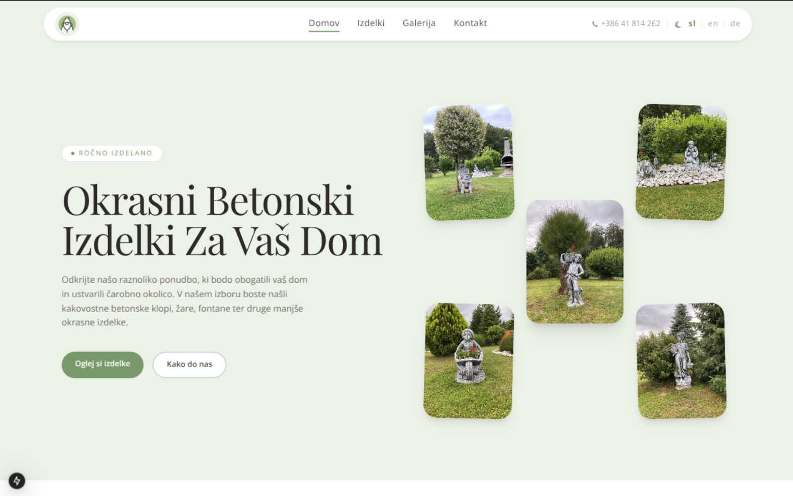

# iobi

Website and product catalogue for a family business that makes handcrafted concrete garden
products: fountains, planters, statues and more. Visitors can browse products by category,
view the gallery and find contact details. The site is in Slovenian, English and German.

**Status:** going live in December 2026. The site is being upgraded step by step (see [`PLAN.md`](PLAN.md)).



## Tech stack

- **Next.js 16** (App Router) and **React 19**
- **Tailwind CSS v4**
- **PocketBase** as the backend and CMS, self-hosted with **Coolify**
- Headless UI, Swiper and PhotoSwipe for the menu, product slider and lightbox

## Features

- Product catalogue loaded from PocketBase, 20 products per page, with a category filter
- Three languages (sl, en, de)
- Gallery with a lightbox
- The client adds and edits products in the PocketBase admin panel, no code needed

## Run it locally

You need Node.js 20 or newer.

Create `.env.local` with:

```bash
NEXT_PUBLIC_ENVIRONMENT=production
NEXT_PUBLIC_POCKETBASE_URL=https://your-pocketbase-url
```

Then:

```bash
npm install
npm run dev     # http://localhost:3000
```

### Your own PocketBase

1. Run `docker compose up` and create a superuser in the admin panel.
2. Go to **Settings → Import collections**, load `pocketbase/pb_schema.json` and turn on
   **"Merge with the existing collections"**.
3. Add the categories and some test products: `node scripts/seed-test-data.mjs`

## Next steps

The upgrade plan is in [`PLAN.md`](PLAN.md). It includes moving to TypeScript and putting the language in the URL.
